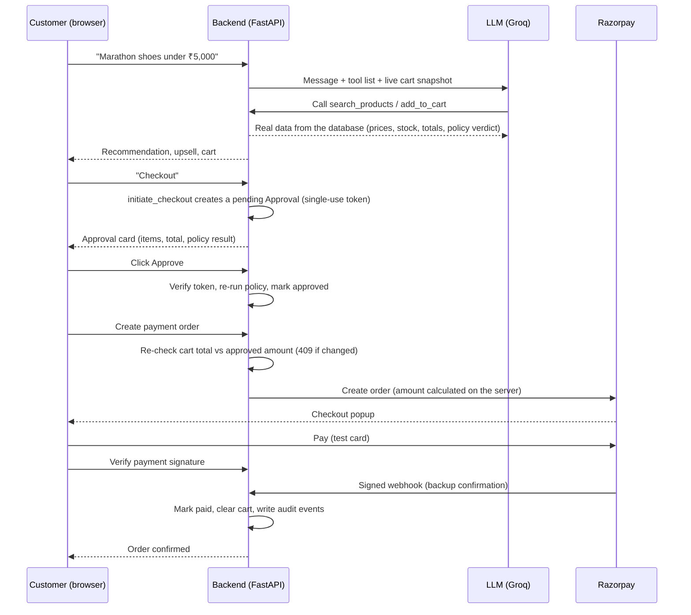
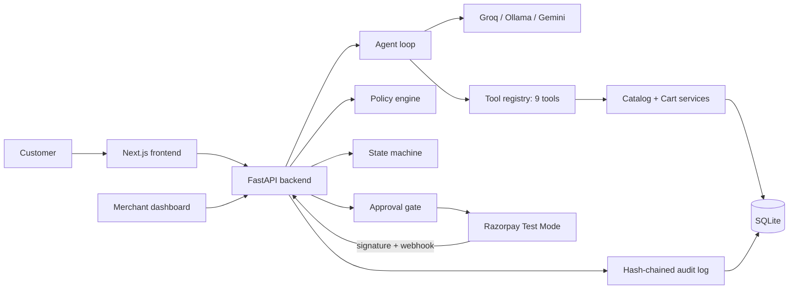

# ⚡ RazorFlow AI

### An AI shopping agent that can recommend and build a cart, but can never authorize a payment on its own.

**Discover → Recommend → Upsell → Policy check → Human approval → Razorpay → Verified order → Audit trail**

[](backend/tests)
[](backend)
[](frontend)
[](https://razorpay.com/docs/payments/test-mode/)
[](LICENSE)

🎬 **Demo video:** https://youtu.be/wim7gSKLrIA

> Built for the **Razorpay Buildathon, Track 01: AI Growth & Agentic Commerce**.
> This is a hackathon-grade prototype running in Razorpay **Test Mode** with synthetic data. See [Known limitations](#-known-limitations).

---

## 📌 Overview

AI can already tell you what to buy. The harder question is whether an AI agent can safely go from *"I need running shoes under ₹5,000"* to a real transaction.

RazorFlow AI answers that by splitting responsibilities:

| The AI (LLM) can… | The backend (plain code) decides… |
|---|---|
| Understand the request | Prices, stock and totals (read from the database) |
| Search the catalog through tools | Whether the cart is allowed by the spending policy |
| Recommend products and suggest add-ons | Whether the user explicitly approved this exact amount |
| Add, change and remove cart items | The Razorpay order, signature verification and order status |
| Ask to start checkout | What gets written to the audit trail |

The LLM has **no tool** to approve, pay, set a price or change a limit. It can only *request* checkout, which creates a pending approval that a human must confirm.

---

## ✨ Features

**Buyer experience**
- Natural-language product discovery (budget, use case, "something cheaper", "add the socks").
- Explainable recommendations and relevant upsell suggestions, with a reason shown on each card.
- Conversational cart: add, remove and change quantities by chat or by buttons. Totals always come from the backend.
- Approval card showing items, total, policy result and remaining budget before any payment.
- Razorpay Test Mode checkout, with a clear recovery path (Retry payment) if a payment fails.

**Safety and trust**
- Deterministic policy engine (transaction, quantity, upsell and session-spend limits).
- Single-use approval tokens, stale-amount detection and policy re-validation.
- Server-side Razorpay order creation, signature verification and signed webhooks.
- SHA-256 hash-chained audit trail with a live verification endpoint.

**Merchant experience**
- Dashboard with revenue, average order value, AI conversion, upsell revenue and a with-vs-without-AI comparison.
- Orders table that separates live purchases from seeded demo data.
- Audit ledger with a "chain intact" indicator.
- Agent-readable catalog published at `/.well-known/ai-commerce.json` so other agents can discover the shop.

---

## 🔄 How one purchase works



The same flow, step by step:

1. **Understand.** `POST /api/agent/chat` sends the message to the agent. The LLM may call up to 9 tools in a short loop (maximum 4 rounds).
2. **Ground in data.** Every price, stock level and total comes from the database. The LLM never passes a price. The backend snapshots the price onto the cart line.
3. **Check the rules.** Every cart change returns the new total and a policy verdict.
4. **Request approval.** `initiate_checkout` creates a pending `Approval` with a random single-use token and a frozen copy of the active policy.
5. **Approve.** The user's click calls `/api/checkout/approve`. The token is compared in constant time, cleared on first use, and the policy is re-run.
6. **Pay.** `/api/payment/create-order` rejects the request if the cart total changed since approval, re-checks the policy, then creates the Razorpay order with a server-calculated amount.
7. **Confirm.** The payment signature is verified server-side. A signed webhook and a status poll act as backups if the browser result is lost.
8. **Record.** The order is marked paid, the cart is cleared, and every step is written to the audit trail.

---

## 🛡️ Safety model

The browser and the LLM are both treated as untrusted for financial state.

| Risk | Defense |
|---|---|
| LLM invents a price or total | Prices and totals come from the database. Tools take no price argument. |
| LLM or user exceeds spending rules | Deterministic policy engine, checked at cart time, approval time and order-creation time |
| LLM "approves" a purchase | There is no tool for it. Approval is a separate user action with a single-use token. |
| Approval replayed or double-clicked | Token is compared with `hmac.compare_digest` and cleared on first use (second attempt returns 403) |
| Cart changed after approval | Stale-amount check at order creation returns 409 |
| Forged payment confirmation | Signature verified server-side against the order stored in your own database |
| Lost browser result | Signed webhook plus a 30-second status poll |
| Duplicate webhook deliveries | Already-processed payment ids are ignored |
| False "payment succeeded" messages from the AI | Approval and payment events get fixed, non-LLM replies |
| Secrets leaking | Razorpay secret stays on the server; the browser only receives the public key id |
| Floating-point money errors | Money is stored as integer paise |
| Abuse of money routes | In-memory rate limit of 120 requests/min/IP on `/api/payment/*` and `/api/checkout/*` |

> Failed payments consume **no** spending budget. Only `paid` orders count toward the session limit.

---

## 🏗️ Architecture



### The agent

The agent is a bounded tool-calling loop, not a free-running autonomous process.

| Tool | Purpose |
|---|---|
| `search_products`, `get_product`, `check_stock`, `get_related_products` | Read the catalog |
| `create_cart`, `add_to_cart`, `update_quantity`, `remove_from_cart` | Change the cart (prices set by the backend) |
| `initiate_checkout` | Request approval only; it does not pay |

Reliability features:
- **Groq key rotation:** rotates through several API keys when one is rate-limited. `LLM_PROVIDER=auto` chains Ollama → Groq → Gemini.
- **Zero-LLM responses** for approval and payment events and for "show me more options", so the agent cannot misreport money events and quota is saved.
- **Graceful degradation:** if every provider fails, the user gets a clear message instead of a stack trace.
- **Restart recovery:** chat history is rebuilt from stored `AIInteraction` rows.

---

## 🧰 Tech stack

| Layer | Technology |
|---|---|
| Frontend | Next.js 16, React 19, TypeScript, Tailwind CSS 4, shadcn/ui, Lucide |
| Backend | Python 3.12, FastAPI, Pydantic, SQLAlchemy |
| Database | SQLite (15 SQLAlchemy models) |
| AI | Groq `qwen/qwen3.6-27b` with multi-key rotation; Ollama and Gemini supported |
| Payments | Razorpay Test Mode (Orders API, checkout.js, webhooks) |
| Testing | pytest (181 tests) |

---

## 📁 Project structure

```text
RazorFlow-AI/
├── backend/
│   ├── models/          # SQLAlchemy models
│   ├── schemas/         # Pydantic request/response contracts
│   ├── routers/         # catalog, cart, agent, checkout, payment, policy,
│   │                    #   audit, dashboard, demo, well-known
│   ├── services/        # policy engine, state machine, audit, checkout, payment
│   │   └── ai/          # agent loop, tool registry, prompts, LLM clients
│   ├── tests/           # 9 test files + conftest (181 tests)
│   ├── init_db.py       # creates tables, seeds merchant, policy, 15-product catalog
│   ├── seed_demo_history.py
│   ├── requirements.txt
│   ├── .env.example
│   └── main.py
├── frontend/
│   └── src/
│       ├── app/         # landing, buyer, merchant, setup
│       ├── components/  # chat, commerce, audit, merchant, demo, ui
│       └── lib/         # API client, types, time helpers
├── docs/                # architecture, api-contract, policy-spec, state-machine,
│                        #   database-schema, implementation-plan
└── README.md
```

---

## ⚡ Getting started

**Prerequisites:** Python 3.12, Node.js 20+, a Groq API key (or a local Ollama), and Razorpay **Test Mode** keys.

Run all backend commands from the **repository root**.

### 1. Clone and install the backend

```bash
git clone https://github.com/tisha-varma/RazorFlow-AI.git
cd RazorFlow-AI

python -m venv venv
source venv/bin/activate          # Windows: venv\Scripts\activate

pip install -r backend/requirements.txt
```

### 2. Configure environment variables

```bash
cp backend/.env.example backend/.env    # Windows: copy backend\.env.example backend\.env
```

Then edit `backend/.env`:

| Variable | Description |
|---|---|
| `LLM_PROVIDER` | `groq` (default), `ollama`, `gemini` or `auto` (Ollama → Groq → Gemini) |
| `LLM_API_KEYS` | Comma-separated keys, rotated when one is rate-limited |
| `LLM_API_KEY` | Single key (used when `LLM_API_KEYS` is empty) |
| `LLM_MODEL` | Default `qwen/qwen3.6-27b` |
| `RAZORPAY_KEY_ID` / `RAZORPAY_KEY_SECRET` | **Test Mode** keys from the Razorpay dashboard |
| `RAZORPAY_WEBHOOK_SECRET` | Secret you set when creating the webhook |
| `DEMO_MODE` | `True` shows demo controls and enables demo endpoints. Set `False` otherwise. |
| `DATABASE_URL` | Default `sqlite:///./razorflow.db` |

> Never commit `.env`. Use Test Mode credentials only.

### 3. Seed the database and start the backend

```bash
python -m backend.init_db
python -m uvicorn backend.main:app --reload --port 8000
```

- API docs (Swagger): http://localhost:8000/docs
- Run **exactly one worker** (the default). Session state is held in process memory.

### 4. Start the frontend

```bash
cd frontend
npm install
npm run dev
```

Open http://localhost:3000. Pages: `/buyer`, `/merchant`, `/setup`.
The frontend calls `http://localhost:8000/api` by default; override with `NEXT_PUBLIC_API_URL`.

### 5. Webhooks (optional for local development)

Razorpay cannot reach `localhost`. To receive webhooks locally, expose the backend with a tunnel (for example cloudflared or ngrok), add `<public-url>/api/payment/webhook` in the Razorpay dashboard with events `payment.captured` and `payment.failed`, and put the same secret in `RAZORPAY_WEBHOOK_SECRET`.

Without a webhook, payments are still confirmed by the browser's signature verification and the status poll.

---

## 🧪 Testing

```bash
pip install -r backend/requirements.txt
python -m pytest backend/tests -q
```

181 tests cover: catalog search, cart math, policy boundaries, approval replay protection, stale amounts, payment signature verification and failure, duplicate webhooks, retry after failure, audit-chain verification, live-vs-demo revenue separation, LLM fallback behavior, agent tools and an end-to-end checkout chain. Payment tests use a mocked gateway and real HMAC test vectors, so no network or Razorpay keys are needed.

Frontend checks:

```bash
cd frontend
npm run lint
npm run build
```

---

## 🎬 Demo scenarios

**1. Successful AI purchase.**
*"I need running shoes for a marathon under ₹5,000."* → search → recommend RunPro Sprint (₹4,499) → offer Performance Running Socks (₹499) → cart ₹4,998 → policy passes → approve → Razorpay test checkout (card `4100 2800 0000 1007`) → payment verified → order confirmed → audit trail → merchant dashboard updates.

**2. Payment failure and recovery.**
Same flow, but pay with the decline card `4100 2800 0006 0003` (or use the in-app **Simulate decline** control). The user sees a recovery card with **Retry payment**. A retry reuses the same approval and creates a fresh Razorpay order. Both attempts appear in the audit trail.

**3. Policy block.**
Add enough items to exceed ₹5,000. The purchase is blocked with an explanation, and no approval is created.

---

## ⚙️ Commerce policy

Default policy (editable at `/setup` or in the buyer view):

| Setting | Default | Enforced today |
|---|---|---|
| Maximum transaction | ₹5,000 | ✅ |
| Minimum transaction | ₹0 | ✅ |
| Maximum quantity per item | 5 | ✅ |
| Maximum upsell amount | ₹2,000 | ✅ |
| Session spending limit | ₹10,000 | ✅ (counts paid orders only) |
| Human approval before payment | Always | ✅ (the gate is always created; the setting is display-only) |
| `allow_upsell` flag | Enabled | ⏳ stored, not yet enforced |
| `allow_auto_retry` flag | Disabled | ⏳ stored, not yet enforced (retries are always user-initiated) |

Policies live in the database. Changing one logs a `POLICY_CHANGED` event, and every approval freezes the limits that applied at that moment.

---

## 🧭 State machine

```text
IDLE → DISCOVERING → RECOMMENDING → CART_BUILDING → UPSELLING → POLICY_CHECK
     → AWAITING_APPROVAL → PAYMENT_PENDING → PAYMENT_SUCCESS → ORDER_CONFIRMED
```

`PAYMENT_FAILED` loops back to `PAYMENT_PENDING` for a user-initiated retry, and `CANCELLED` is available. In total there are 12 states, and invalid transitions return `409`. The current state is kept in memory and rebuilt from approval and order records after a restart.

---

## 🧾 Audit trail

Every important action is recorded, for example:

```text
USER_INTENT_RECEIVED → SEARCH_PERFORMED → RECOMMENDATION_MADE → UPSELL_OFFERED
→ UPSELL_ACCEPTED → POLICY_CHECK_PASSED → PAYMENT_APPROVAL_REQUESTED
→ PAYMENT_APPROVED → PAYMENT_ORDER_CREATED → PAYMENT_SUCCESS → ORDER_CONFIRMED
```

Each row stores `hash = SHA-256(previous_hash + event_type + event_data + actor + session_id)`. `GET /api/audit/verify` recomputes the chain and reports where it breaks, if anywhere.

The audit trail is **tamper-evident, not immutable**: it detects edits to the hashed fields of earlier rows, but it is not externally anchored and does not cover every column (for example timestamps).

---

## 🏪 Merchant analytics and demo data

Metrics are labeled so demo data never masquerades as live revenue:

- `RF-*` live buyer purchases (real Test Mode payments)
- `HIST-*` seeded demo history
- `DEMO-*` scripted demo triggers

Live metrics use only real paid orders. The "without AI" comparison is a **derived baseline** (paid orders minus upsell lines), not a controlled experiment, so treat it as illustrative.

---

## 🚧 Known limitations

This project is demo-grade by design. The payment and approval flow is production-shaped, but the surrounding system is not production-ready.

- **No authentication.** Sessions are client-generated UUIDs. Merchant endpoints (policy, dashboard, audit) and cart endpoints are not access-controlled.
- **Single merchant, single worker, SQLite.** Session state, chat history and the rate limiter live in process memory.
- **Concurrency.** There are no row-level locks, so simultaneous verify and webhook calls for one payment, or concurrent audit writes, are not fully serialized.
- **Webhook reconciliation.** Events older than 5 minutes are ignored, and payment status is read from the local database rather than from Razorpay's API.
- **Two stored policy flags** (`allow_upsell`, `allow_auto_retry`) are not enforced yet.
- **LLM calls** to Groq and Gemini are synchronous inside async handlers, so a slow call can stall other requests.
- **Test Mode only.** No refunds, settlements or disputes.
- **Metrics** are honest at small scale but not statistically powered.

---

## 🗺️ Roadmap

- Real authentication and roles, plus ownership checks on carts, approvals and orders
- Multi-merchant support with per-merchant keys
- PostgreSQL, versioned migrations and Redis-backed state
- Row-level locking, unique constraints on payment ids and Razorpay API reconciliation
- Async LLM clients and sturdier failure detection
- Enforce all policy flags
- Live keys, refunds, settlements, order tracking and receipts
- Standardized agent-commerce protocols

---

## 👩‍💻 Author

**Tisha Varma**: GitHub [@tisha-varma](https://github.com/tisha-varma)

⭐ If you find the project interesting, star the repository.
